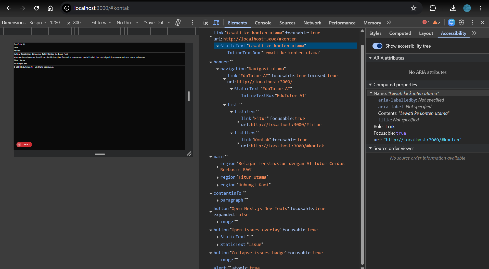
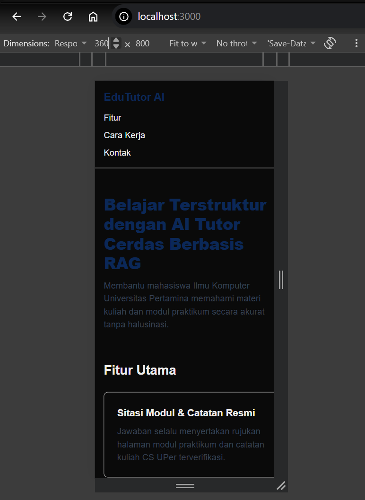
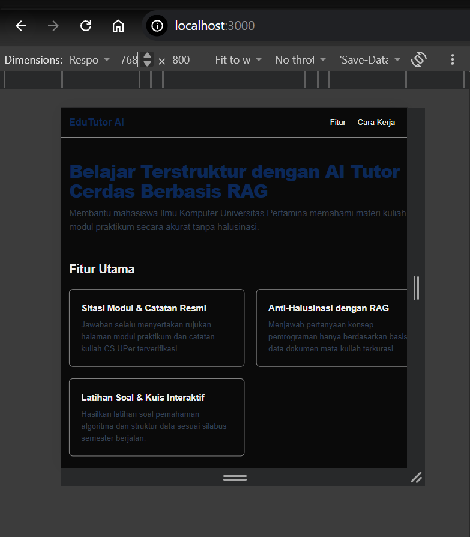
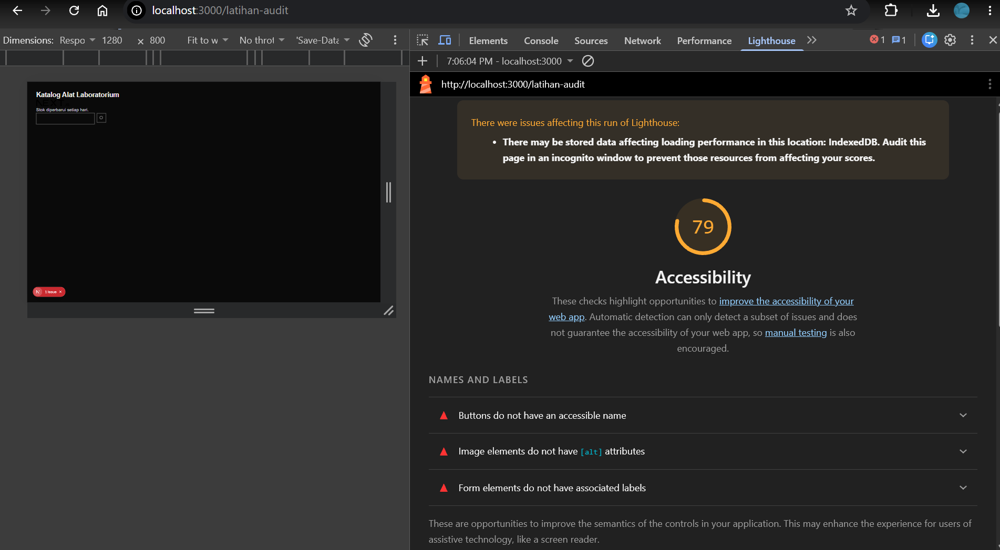
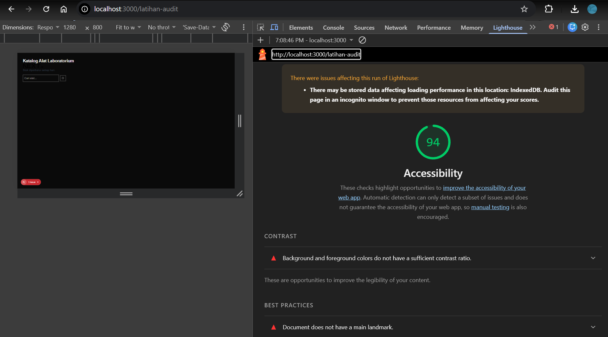
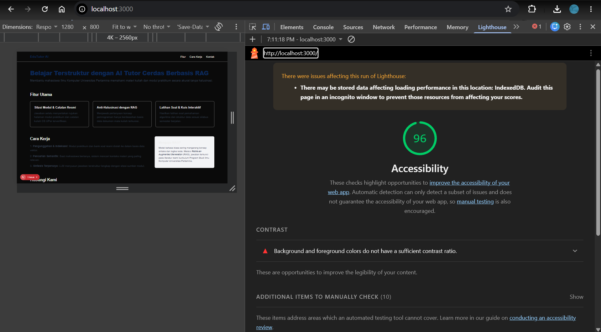

# Dokumen Teknis Modul 2 — HTML Semantik, Tailwind CSS, dan Aksesibilitas

Nama/NIM   : Erlangga Aditya Permana / 105224038  
Repositori : https://github.com/xvasgit/PemWeb26.git  

---

## 1. Struktur Semantik

### Kerangka Landmark dan Hierarki Judul Halaman Utama

Halaman utama produk **EduTutor AI** dibangun menggunakan elemen-elemen semantik standar HTML5 yang secara otomatis terpetakan menjadi ARIA Landmark Roles pada pohon aksesibilitas peramban (*Accessibility Tree*). Pendekatan ini memastikan struktur halaman terbaca secara terprogram (*programmatically determinable*) sesuai kriteria WCAG 2.2 Kriteria 1.3.1 (Info and Relationships).

#### 1. Kerangka Landmark ARIA
Berikut adalah elemen semantik yang diimplementasikan beserta peran landmark ARIA yang dihasilkannya:

| Elemen HTML | Atribut Terkait | Peran Landmark ARIA | Fungsi & Perilaku Aksesibilitas |
| :--- | :--- | :--- | :--- |
| `<a>` (Skip link) | `href="#konten"`, `className="sr-only focus:not-sr-only focus:p-2"` | `link` | Memungkinkan pengguna papan ketik melompati deretan navigasi berulang dan langsung menuju area konten utama. Disembunyikan secara visual (`sr-only`) dan hanya muncul saat menerima fokus (`focus:not-sr-only`). |
| `<header>` | `className="border-b"` | `banner` | Landmark pembuka di tingkat atas dokumen yang memuat identitas merek dan navigasi global situs. |
| `<nav>` | `aria-label="Navigasi utama"` | `navigation` | Landmark navigasi primer. Atribut `aria-label` memberikan nama yang dapat diakses (*accessible name*) agar pengguna pembaca layar mengetahui konteks navigasi ini dengan jelas. |
| `<main>` | `id="konten"` | `main` | Landmark tunggal penampung konten primer halaman. Menjadi target lompatan dari skip link (`#konten`). |
| `<section>` | `aria-labelledby="judul-utama"` | `region` | Landmark region untuk bagian pengenalan / hero. Diberi nama yang dapat diakses melalui referensi heading `h1`. |
| `<section>` | `id="fitur"`, `aria-labelledby="judul-fitur"` | `region` | Landmark region untuk fitur utama produk, diberi nama yang dapat diakses melalui referensi heading `h2`. |
| `<section>` | `id="kontak"`, `aria-labelledby="judul-kontak"` | `region` | Landmark region untuk bagian kontak / formulir, diberi nama yang dapat diakses melalui referensi heading `h2`. |
| `<footer>` | `className="border-t"` | `contentinfo` | Landmark penutup di tingkat atas dokumen yang memuat informasi hak cipta, kepemilikan, dan informasi tambahan situs. |


#### 2. Hierarki Judul (Heading Hierarchy)
Struktur judul disusun secara runtut dan hierarkis tanpa ada tingkatan yang terlewati (*no skipped heading levels*):
- **Level 1 (`<h1>`)**:  
  - Teks: `"Belajar Terstruktur dengan AI Tutor Cerdas Berbasis RAG"`  
  - Terdapat tepat satu elemen `<h1>` pada seluruh dokumen halaman, menyatakan proposisi nilai dan topik utama dari produk.
- **Level 2 (`<h2>`)**:  
  - Teks: `"Fitur Utama"` (`id="judul-fitur"`) pada section fitur.
  - Teks: `"Cara Kerja"` (`id="judul-cara"`) pada section cara kerja.
  - Teks: `"Hubungi Kami"` (`id="judul-kontak"`) pada section kontak.
  - Setiap section memiliki sub-judul tingkat kedua yang langsung berada di bawah lingkup topik `<h1>`.
- **Level 3 (`<h3>`)**:  
  - Digunakan untuk masing-masing judul kartu fitur (`<article>`) dan judul bilah informasi pendukung `<aside>` ("Mengapa RAG?").

#### 3. Bahasa Dokumen dan Metadata
- Atribut `lang="id"` ditetapkan pada elemen `<html>` di `app/layout.tsx` untuk memastikan mesin pembaca layar (*screen reader*) menggunakan mesin sintesis suara dan aturan pelafalan fonetik bahasa Indonesia yang tepat.
- Metadata `title` dan `description` dikonfigurasi melalui objek `Metadata` Next.js untuk keterbacaan tab peramban dan pengindeksan mesin pencari.

### Tangkapan Layar Pohon Aksesibilitas pada DevTools

Berikut adalah bukti tangkapan layar pohon aksesibilitas penuh (*Full-page accessibility tree*) yang diambil melalui Chrome DevTools (Panel *Elements* > Tab *Accessibility* > Opsi *Enable full-page accessibility tree*):



*Gambar 1.1: Pohon Aksesibilitas Halaman Utama yang menunjukkan keberadaan landmark banner, navigation, main, region ("Belajar Terstruktur...", "Fitur Utama", "Hubungi Kami"), contentinfo, serta hierarki judul h1 dan h2.*

---

## 2. Tata Letak Responsif

### Keputusan Teknis Pemilihan Kelas Flexbox, Grid, dan Breakpoint

Tata letak halaman utama **EduTutor AI** dirancang dengan mengombinasikan CSS Flexbox dan CSS Grid menggunakan utility-classes Tailwind CSS. Desain disusun menggunakan pendekatan **Mobile-First**, di mana gaya dasar ditulis tanpa awalan (*prefix*) untuk viewport terkecil (ponsel), kemudian diperluas secara bertahap menggunakan breakpoint Tailwind (`sm:`, `lg:`) seiring bertambahnya lebar layar peramban.

#### 1. Komponen Navigasi (CSS Flexbox)
- **Kelas yang Digunakan**:  
  `<nav className="mx-auto flex max-w-6xl flex-col gap-3 p-4 sm:flex-row sm:items-center sm:justify-between">`  
  `<ul className="flex flex-col gap-2 sm:flex-row sm:gap-6">`
- **Alasan Pemilihan Flexbox**:  
  Navigasi adalah komponen tata letak satu dimensi (*one-dimensional layout*). Flexbox sangat ideal untuk mendistribusikan item secara fleksibel dalam satu sumbu utama (baris atau kolom) dan meratakan posisi vertikal (*cross-axis*).
- **Perilaku Responsif**:
  - **Ponsel (< 640 px)**: Menggunakan `flex-col gap-3` pada kontainer `<nav>` dan `flex-col gap-2` pada daftar menu `<ul>`. Hal ini membuat logo dan menu tautan tersusun rapi secara bertumpuk vertikal dengan target sentuh (*touch target*) yang lapang dan mudah diakses jari tanpa menimbulkan penyempitan horizontal.
  - **Layar Lebar (≥ 640 px / breakpoint `sm`)**: Awalan `sm:flex-row` mengubah arah sumbu utama menjadi mendatar (baris), `sm:items-center` menyelaraskan logo dan menu secara vertikal, serta `sm:justify-between` memisahkan logo di sisi kiri dan tautan menu di sisi kanan.

#### 2. Kartu Fitur (CSS Grid)
- **Kelas yang Digunakan**:  
  `<ul className="mt-6 grid grid-cols-1 gap-6 sm:grid-cols-2 lg:grid-cols-3">`  
  `<article className="h-full rounded-lg border p-6 shadow-sm">`
- **Alasan Pemilihan Grid**:  
  Daftar kartu fitur adalah tata letak dua dimensi (*two-dimensional layout*). CSS Grid memastikan pembagian kolom dan baris yang seragam, jarak antar kartu yang konsisten melalui `gap-6` (menghindari kerumitan *margin collapsing*), serta penggunaan `h-full` pada `<article>` agar setiap kartu pada baris yang sama memiliki tinggi yang persis sama terlepas dari panjang deskripsi teksnya.
- **Perilaku Responsif**:
  - **Ponsel (< 640 px)**: `grid-cols-1` menampilkan kartu dalam 1 kolom vertikal selebar kontainer.
  - **Tablet (≥ 640 px / breakpoint `sm`)**: `sm:grid-cols-2` menampilkan kartu dalam 2 kolom sejajar.
  - **Desktop (≥ 1024 px / breakpoint `lg`)**: `lg:grid-cols-3` menampilkan kartu dalam 3 kolom seimbang (masing-masing 33.3%).

#### 3. Tata Letak Dua Kolom Konten & Aside (CSS Grid dengan Arbitrary Value)
- **Kelas yang Digunakan**:  
  `<div className="my-8 grid gap-8 lg:grid-cols-[2fr_1fr]">`
- **Alasan Pemilihan Arbitrary Value**:  
  Tata letak antara bagian "Cara Kerja" dan bilah informasi "Mengapa RAG?" memerlukan pembagian proporsi asimetris yang spesifik: 2 bagian untuk konten utama (`2fr` ≈ 66.7%) dan 1 bagian untuk informasi pendukung (`1fr` ≈ 33.3%). Fitur *arbitrary value* Tailwind `lg:grid-cols-[2fr_1fr]` memungkinkan deklarasi rasio fraksi tersebut secara langsung dan presisi.
- **Perilaku Responsif**:
  - **Ponsel & Tablet (< 1024 px)**: Elemen konten dan `<aside>` bertumpuk secara vertikal (default `grid` 1 kolom) dengan jarak pemisah `gap-8`, menjaga keterbacaan teks tanpa memaksakan dua kolom pada layar sempit yang berpotensi memicu teks terpotong atau desak-desakan.
  - **Desktop (≥ 1024 px / breakpoint `lg`)**: `lg:grid-cols-[2fr_1fr]` mengaktifkan tata letak dua kolom berdampingan secara otomatis.

#### 4. Penataan Kontainer dan Warna Merek
- **Pembatas Lebar**: Kontainer utama dibungkus kelas `mx-auto max-w-6xl p-4` untuk mencegah tata letak meregang tak terhingga (*stretched layout*) pada monitor beresolusi tinggi, mempertahankan lebar optimal baca (*readability length*).
- **Variabel Warna Merek**: Warna merek dikonfigurasi pada `@theme inline` di `app/globals.css` dengan nilai `--color-brand: #0b2858;` dan diimplementasikan melalui kelas `text-brand`. Kontras rasio warna `#0b2858` terhadap latar putih `#ffffff` mencapai **14,38 : 1**, jauh melampaui batas minimum WCAG AA (4,5 : 1) maupun WCAG AAA (7 : 1).

---

### Tangkapan Layar pada Tiga Lebar Layar

Pengujian responsivitas dilakukan menggunakan Device Toolbar DevTools (`Ctrl + Shift + M`) pada tiga ukuran representatif: 360 px (ponsel kecil), 768 px (tablet), dan 1280 px (desktop). Seluruh tampilan teruji bebas dari gulir horizontal (*no horizontal scrollbar*).

#### 1. Lebar 360 px (Ponsel)

*Gambar 2.1: Tampilan pada lebar 360 px. Navigasi bertumpuk vertikal, kartu fitur tampil dalam 1 kolom, dan informasi aside berada di bawah konten utama.*

#### 2. Lebar 768 px (Tablet)

*Gambar 2.2: Tampilan pada lebar 768 px. Navigasi beralih mendatar (logo kiri, menu kanan), dan kartu fitur tersusun dalam 2 kolom.*

#### 3. Lebar 1280 px (Desktop)

*Gambar 2.3: Tampilan pada lebar 1280 px. Kartu fitur tersusun dalam 3 kolom penuh dan bagian Cara Kerja serta Aside tampil berdampingan dengan rasio 2fr : 1fr.*

---

## 3. Audit Aksesibilitas

### Tabel Skor Lighthouse Sebelum dan Sesudah Perbaikan

Audit aksesibilitas dijalankan menggunakan panel **Lighthouse** pada Chrome DevTools dengan konfigurasi mode *Navigation*, perangkat *Mobile*, dan kategori *Accessibility*.

| Halaman yang Diuji | URL Pengujian | Skor Sebelum Perbaikan | Skor Sesudah Perbaikan | Target Minimal Modul | Status |
| :--- | :--- | :---: | :---: | :---: | :---: |
| **Halaman Latihan** | `http://localhost:3000/latihan-audit` | **79** | **94** | ≥ 90 | **Memenuhi Target** |
| **Halaman Utama Produk** | `http://localhost:3000/` | — | **96** | ≥ 85 | **Memenuhi Target** |

---

### Bukti Tangkapan Layar Audit Lighthouse

#### 1. Halaman Latihan Sebelum Perbaikan (Skor: 79)

*Gambar 3.1: Hasil audit awal halaman latihan (skor 79) dengan temuan kegagalan pada nama tombol, alt gambar, dan label form.*

#### 2. Halaman Latihan Sesudah Perbaikan (Skor: 94)

*Gambar 3.2: Hasil audit halaman latihan setelah perbaikan meningkat menjadi skor 94 (memenuhi target minimal ≥ 90).*

#### 3. Halaman Utama Produk (Skor: 96)

*Gambar 3.3: Hasil audit halaman utama produk memperoleh skor 96, melampaui target kelulusan modul (minimal 85).*

---

### Daftar Audit yang Gagal, Penyebab, dan Perbaikannya

Pengujian awal pada halaman latihan (`app/latihan-audit/page.tsx`) memunculkan 4 audit gagal dari mesin axe-core Lighthouse, ditambah 1 temuan struktural dari inspeksi manual pohon aksesibilitas:

| No | Audit yang Gagal (Lighthouse) | Elemen Bermasalah | Akar Penyebab (*Root Cause*) | Solusi & Arah Perbaikan |
| :---: | :--- | :--- | :--- | :--- |
| 1 | **Image elements do not have `[alt]` attributes** | `` | Elemen `` tidak memiliki atribut `alt`. Pembaca layar akan membacakan URL berkas atau mengabaikan gambar secara keliru. | Menambahkan atribut `alt="Logo Laboratorium"` (atau `alt=""` bila gambar semata-mata dekoratif) untuk memenuhi kriteria WCAG 1.1.1 Non-text Content. |
| 2 | **Background and foreground colors do not have a sufficient contrast ratio** | `<p className="text-gray-300">Stok diperbarui setiap hari.</p>` | Warna abu-abu muda `#d1d5db` di atas latar putih `#ffffff` hanya memiliki rasio kontras 1,48 : 1, di bawah ambang batas minimum WCAG AA 4,5 : 1. | Mengganti kelas warna teks menjadi `text-gray-700` (`#374151`) yang menghasilkan rasio kontras 9,5 : 1 (melebihi standar WCAG 1.4.3 Contrast Minimum). |
| 3 | **Form elements do not have associated labels** | `<input type="search" className="border p-2" />` | Elemen `<input>` tidak memiliki label terkait yang terhubung melalui atribut `id` dan `for`/`htmlFor`. | Menambahkan elemen `<label htmlFor="cari-alat" className="block text-sm font-medium">Cari alat</label>` dan atribut `id="cari-alat"` pada input (WCAG 1.3.1 Info and Relationships). |
| 4 | **Buttons do not have an accessible name** | `<button className="ml-2 border p-2"><svg ...>...</svg></button>` | Elemen `<button>` hanya memuat ikon SVG tanpa teks terlihat maupun atribut label aksesibel, sehingga fungsinya tidak terbaca oleh *screen reader*. | Menambahkan `aria-label="Cari"` pada elemen `<button>` dan menyematkan `aria-hidden="true"` pada elemen `<svg>` agar ikon tidak dibaca ganda (WCAG 4.1.2 Name, Role, Value). |
| 5 | *(Temuan Manual)* **Heading ditulis menggunakan `<div>`** | `<div className="text-2xl font-bold">Katalog Alat Laboratorium</div>` | Judul halaman menggunakan `<div>` sehingga tidak terdaftar sebagai *heading* level 1 pada pohon aksesibilitas. | Mengganti elemen `<div>` menjadi `<h1>Katalog Alat Laboratorium</h1>` untuk menjamin struktur hirarki konten yang benar. |

---

### Hasil Pemeriksaan Manual dengan Papan Ketik (Keyboard Navigation)

Pengujian aksesibilitas tidak hanya mengandalkan skor otomatis, melainkan dilengkapi uji manual navigasi papan ketik sesuai kriteria WCAG 2.1.1 (Keyboard) dan WCAG 2.4.7 (Focus Visible):

1. **Urutan Fokus (*Tab Order*)**:
   - Menekan tombol **Tab** memindahkan fokus secara linier dan logis dari atas ke bawah mengikuti alur visual dokumen:
     - **Lompatan Pertama**: Tautan *Skip link* (`Lewati ke konten utama`) langsung muncul di pojok kiri atas saat menerima fokus.
     - **Navigasi Global**: Fokus berpindah ke logo `EduTutor AI`, disusul menu navigasi `Fitur`, `Cara Kerja`, dan `Kontak`.
     - **Formulir Kontak**: Fokus berpindah ke kolom `Nama lengkap`, lalu ke kolom `Surel`. Teks petunjuk surel dibacakan oleh pembaca layar berkat atribut `aria-describedby="email-bantuan"`.
     - **Pilihan Radio**: Fokus berpindah ke kelompok radio `Peran` yang dibungkus `<fieldset>` dan diidentifikasi oleh `<legend>`. Pilihan radio dapat diganti menggunakan tombol panah (**Arrow Keys**) dan **Spasi**.
     - **Pesan & Kirim**: Fokus berpindah ke area teks `Pesan`, dan diakhiri pada tombol `Kirim` yang dapat dieksekusi dengan menekan tombol **Enter**.
   - Menekan kombinasi **Shift + Tab** mengembalikan fokus ke elemen sebelumnya dengan alur mundur yang sempurna tanpa ada indikasi jebakan fokus (*keyboard trap*).

2. **Garis Fokus (*Focus Indicators*)**:
   - Seluruh elemen interaktif dan kolom isian formulir menggunakan kelas utilitas:
     ```css
     focus-visible:outline-2 focus-visible:outline-offset-2 focus-visible:outline-blue-700
     ```
   - Garis fokus berupa *outline* berwarna biru tebal (2px) dengan jarak pemisah (*offset* 2px) dari batas elemen, sehingga tidak tertutup oleh bingkai asli input dan memberikan sinyal visual yang sangat tegas dan kontras bagi pengguna disabilitas motorik maupun pengguna papan ketik.

---

## 4. Kendala dan Penyelesaian

1. **Kendala Pemetaan Landmark ARIA `<section>`**:  
   *Kendala*: Pada pengujian awal, elemen `<section>` tidak muncul sebagai landmark `region` pada pohon aksesibilitas peramban (*Accessibility Tree*).  
   *Penyelesaian*: Sesuai spesifikasi W3C WAI-ARIA, elemen `<section>` hanya akan dipromosikan menjadi landmark `region` apabila memiliki nama yang dapat diakses (*accessible name*). Masalah ini diselesaikan dengan menambahkan atribut `aria-labelledby` yang mereferensikan elemen judul `<h1>` atau `<h2>` pada masing-masing section.

2. **Kendala Kontras Warna dan Placeholder pada Formulir**:  
   *Kendala*: Mengandalkan teks *placeholder* sebagai label kolom sering kali menghasilkan rasio kontras yang rendah dan teks menghilang saat pengguna mulai mengetik.  
   *Penyelesaian*: Seluruh kolom formulir dilengkapi dengan elemen `<label htmlFor="...">` eksplisit yang terlihat permanen, dan teks petunjuk tambahan dihubungkan menggunakan `aria-describedby`.

3. **Kendala Tombol Ikon Tanpa Teks Aksesibel**:  
   *Kendala*: Tombol pencarian yang hanya berisi ikon SVG gagal pada audit Lighthouse karena tidak memiliki nama yang dapat diakses.  
   *Penyelesaian*: Menambahkan atribut `aria-label="Cari"` pada `<button>` untuk memberikan nama kepada teknologi asistif, serta menambahkan atribut `aria-hidden="true"` pada elemen `<svg>` agar ikon vektor diabaikan oleh pohon aksesibilitas.

---

## 5. Catatan Pemanfaatan AI
Alat, perintah utama, bagian yang digunakan, dan cara memverifikasinya.  
- **Alat**: Antigravity CLI, Gemini 3.8 Flash
- **Perintah Utama**:  
  1. Pembuatan kerangka semantik HTML5 dan pemetaan landmark ARIA.  
  2. Penataan tata letak menggunakan Tailwind CSS Flexbox dan CSS Grid dengan pendekatan *mobile-first*.  
  3. Konfigurasi variabel tema warna merek berasio kontras tinggi pada CSS.  
  4. Penyusunan komponen formulir aksesibel (`<label>`, `<fieldset>`, `<legend>`, `aria-describedby`, dan indikator fokus).  
  5. Analisis audit aksesibilitas Lighthouse serta penyusunan berkas Dokumen Teknis Modul 2.  
- **Bagian yang Digunakan**:  
  - `app/layout.tsx`: Konfigurasi metadata dan atribut bahasa `lang="id"`.  
  - `app/globals.css`: Deklarasi variabel merek `--color-brand: #0b2858;` pada blok `@theme inline`.  
  - `app/page.tsx`: Implementasi skip link, landmark semantik, kartu fitur responsif, dan formulir kontak aksesibel.  
  - `app/latihan-audit/page.tsx`: Pembuatan halaman studi kasus masalah aksesibilitas awal.  
  - `docs/praktikum/modul-02.md`: Penyusunan seluruh bab laporan teknis sesuai format Bagian H dan rubrik penilaian.  
- **Cara Verifikasi**:  
  1. Menjalankan server lokal Next.js (`npm run dev`) dan memverifikasi respons HTML pada `http://localhost:3000`.  
  2. Menguji responsivitas menggunakan Device Toolbar pada ukuran 360 px, 768 px, dan 1280 px untuk memastikan tata letak bebas dari gulir horizontal.  
  3. Memeriksa pohon aksesibilitas (*Full-page accessibility tree*) pada DevTools untuk memvalidasi keberadaan seluruh landmark dan hierarki judul.  
  4. Menjalankan audit Lighthouse kategori *Accessibility* mode *Mobile* untuk mengonfirmasi skor halaman latihan dan halaman utama produk.  
  5. Melakukan uji manual navigasi menggunakan papan ketik (**Tab**, **Shift + Tab**, **Spasi**, **Enter**) untuk memverifikasi alur fokus logis dan keterlihatan garis fokus.
