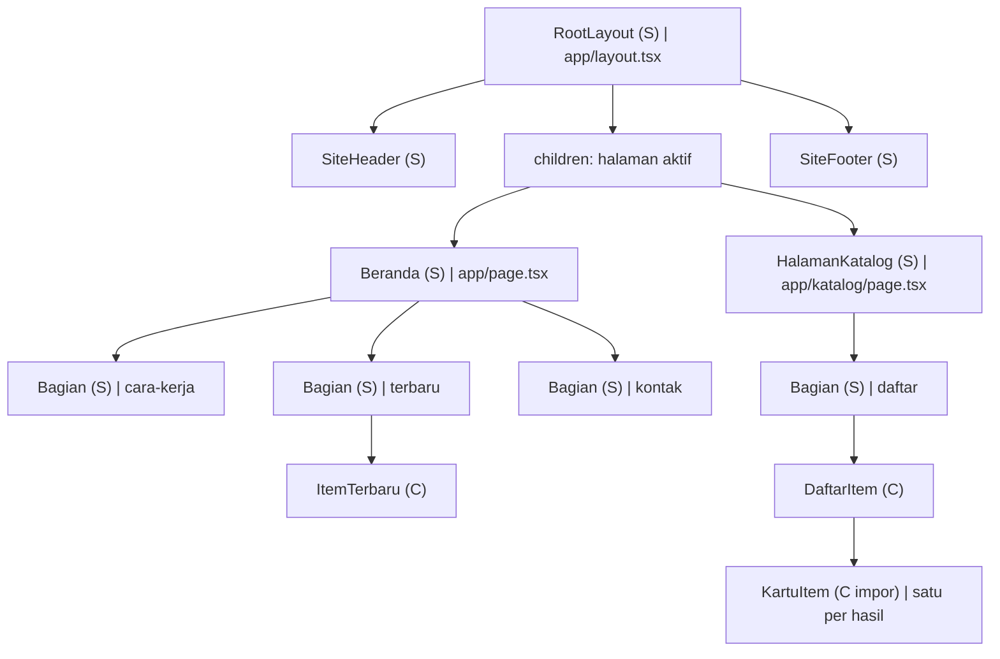
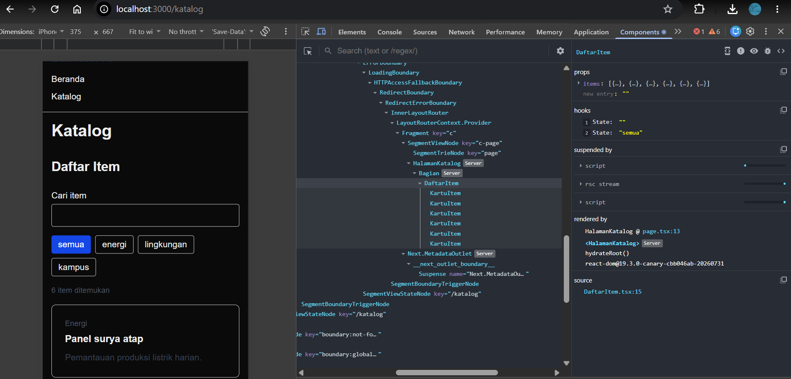
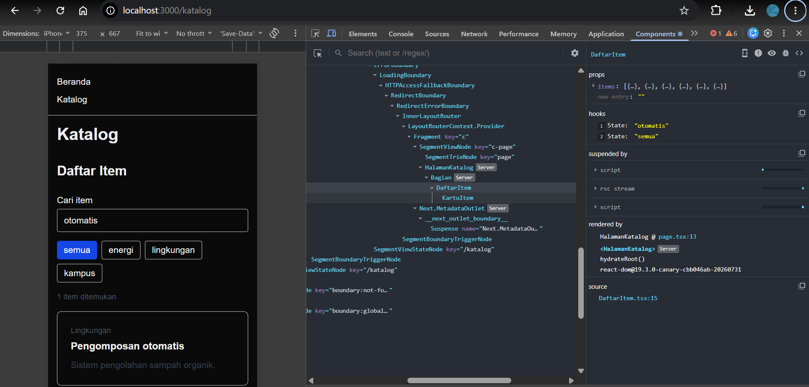
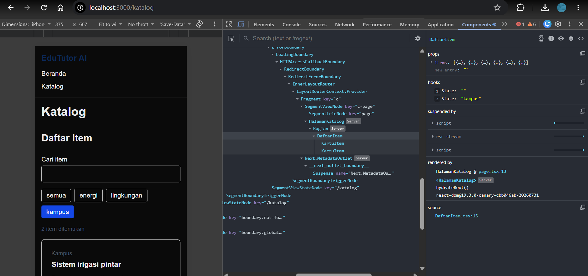
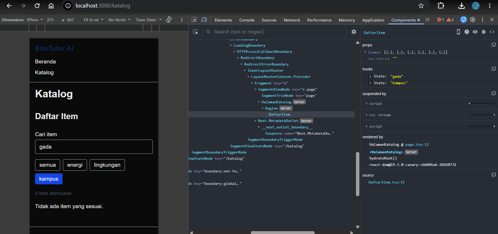
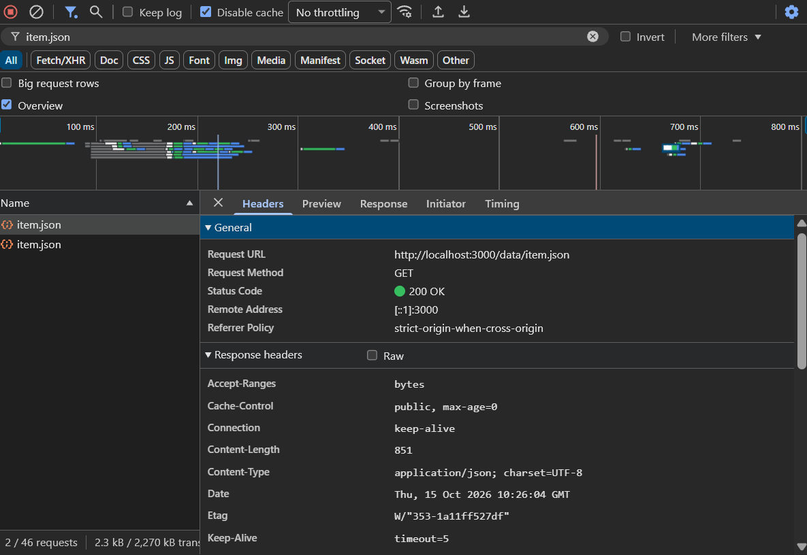
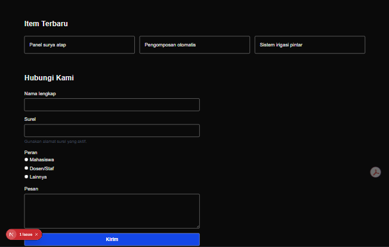
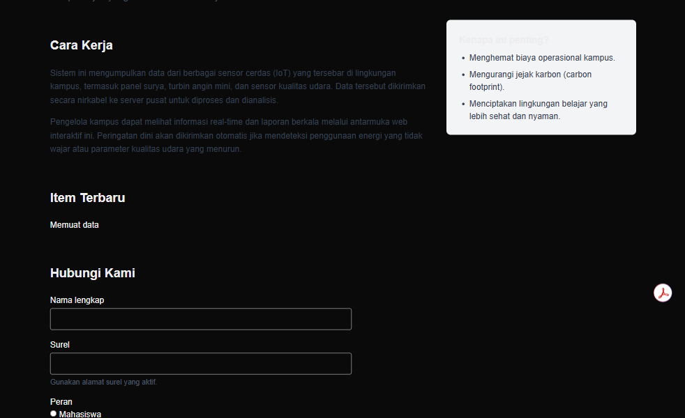
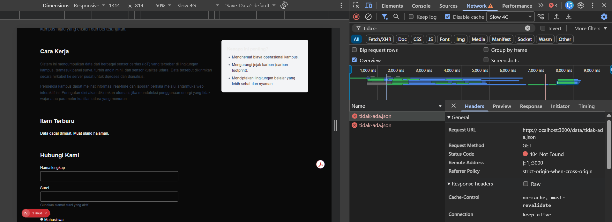
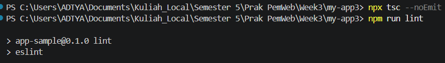

# Dokumen Teknis Modul 3 - TypeScript dan Komponen React

Nama/NIM   : Erlangga Aditya Permana / 105224038  
Repositori : https://github.com/xvasgit/Prak-PemWeb26  

## 1. Tipe Data Produk

### 1.1 Definisi entitas

Entitas produk didefinisikan dalam `lib/tipe.ts` sebagai berikut.

```typescript
export type Kategori = "energi" | "lingkungan" | "kampus";

export interface Item {
  id: number;
  judul: string;
  kategori: Kategori;
  deskripsi: string;
  tersedia: boolean;
  gambar?: string;
}
```

`Item` merepresentasikan satu contoh fasilitas atau perangkat pemantauan kampus. `interface` digunakan untuk menyatakan bentuk objek yang harus dipenuhi oleh data dan props. `Kategori` menggunakan union dari literal string agar nilai kategori dibatasi pada tiga pilihan yang sah. Kesalahan seperti `kategori: "transportasi"` pada data bertipe `Item` dapat dideteksi oleh pemeriksa TypeScript.

Properti `gambar?: string` bersifat opsional karena sebuah item tetap dapat ditampilkan melalui judul, kategori, deskripsi, dan status ketersediaannya tanpa gambar. Saat ini enam data tidak mengisi `gambar`, dan `KartuItem` juga belum menampilkan gambar. Properti ini menyediakan ruang pengembangan tanpa mewajibkan gambar untuk setiap data.

`id` digunakan sebagai identitas stabil untuk `key` daftar. `tersedia` mengendalikan penampilan pesan **Sementara tidak tersedia** pada kartu. Pada `KartuItem`, `Record<Kategori, string>` mewajibkan adanya label tampilan untuk setiap kategori.

### 1.2 Data tiruan

`lib/data.ts` mengekspor `daftarItem: Item[]` untuk halaman katalog. Salinannya dalam format JSON berada di `public/data/item.json` untuk demonstrasi Fetch API pada beranda.

| ID | Judul | Kategori | Tersedia |
| --- | --- | --- | --- |
| 1 | Panel surya atap | energi | Ya |
| 2 | Pengomposan otomatis | lingkungan | Ya |
| 3 | Sistem irigasi pintar | kampus | Tidak |
| 4 | Turbin angin mini | energi | Ya |
| 5 | Sensor kualitas udara | lingkungan | Ya |
| 6 | Lampu jalan pintar | kampus | Ya |

Kedua sumber memuat enam item yang sama pada saat penelaahan. Data ini merupakan data tiruan, bukan pembacaan sensor langsung. TypeScript memeriksa data dalam `lib/data.ts`, sedangkan anotasi `Item[]` pada hasil `res.json()` tidak memvalidasi struktur JSON saat aplikasi berjalan.

## 2. Struktur Komponen

### 2.1 Diagram pohon komponen akhir

Keterangan: **S** adalah Server Component, **C** adalah Client Component, dan **C impor** adalah komponen yang masuk ke bagian client karena diimpor oleh Client Component. Cabang beranda dan katalog merupakan alternatif halaman yang dirender melalui `children` pada layout.



### 2.2 Komponen, props, dan penggunaan

| Komponen | Props dan tipe | Tempat digunakan | Peran |
| --- | --- | --- | --- |
| `SiteHeader` | `namaProduk: string`; `tautan: Tautan[]`, dengan `Tautan = { href: string; label: string }` | `app/layout.tsx`, tampil di beranda dan katalog | Identitas produk dan navigasi global. |
| `SiteFooter` | `namaProduk: string` | `app/layout.tsx`, tampil di beranda dan katalog | Informasi hak cipta yang konsisten. |
| `Bagian` | `id: string`; `judul: string`; `children: React.ReactNode` | Tiga kali di `app/page.tsx` dan sekali di `app/katalog/page.tsx` | Pembungkus `<section>` dengan judul dan hubungan `aria-labelledby`. |
| `KartuItem` | `item: Item` | `components/DaftarItem.tsx`, untuk setiap item hasil penyaringan | Menampilkan kategori, judul, deskripsi, dan kondisi tidak tersedia. |
| `DaftarItem` | `items: Item[]` | `app/katalog/page.tsx`, di dalam `Bagian` | Pencarian, filter kategori, jumlah hasil, dan daftar kartu. |
| `ItemTerbaru` | Tidak menerima props | `app/page.tsx`, di dalam `Bagian` berjudul Item Terbaru | Mengambil JSON dan menampilkan tiga item pertama. |

### 2.3 Alasan pemecahan dan batas client

Header dan footer diletakkan di layout agar tersedia pada kedua halaman tanpa menyalin markup. `Bagian` memusatkan struktur section dan menerima `children` sehingga dapat membungkus paragraf, formulir, maupun komponen interaktif. `KartuItem` memisahkan tampilan satu item dari logika pencarian di `DaftarItem`.

`SiteHeader`, `SiteFooter`, dan `Bagian` merupakan tiga komponen berprops bertipe yang dipakai lintas halaman; `Bagian` juga memiliki beberapa pemanggilan langsung. `KartuItem` dipakai berulang untuk setiap hasil. Saat ini `DaftarItem` dan `ItemTerbaru` masing-masing baru dipasang pada satu tempat, meskipun sudah dipisahkan sebagai komponen.

Direktif `"use client"` ditempatkan pada `DaftarItem` karena menggunakan `useState` dan event handler, serta pada `ItemTerbaru` karena menggunakan `useState`, `useEffect`, dan fetch dari peramban. Layout, halaman, dan pembungkus tidak memerlukan direktif tersebut. `KartuItem` tidak memiliki direktif sendiri, tetapi masuk ke bagian client melalui impor di `DaftarItem`. `ItemTerbaru` merender daftar `<li>` langsung dan tidak menggunakan `KartuItem`.

## 3. State dan Interaksi

### 3.1 Alur event hingga render ulang

Halaman katalog meneruskan `daftarItem` sebagai props melalui `<DaftarItem items={daftarItem} />`. Props tersebut dibaca tanpa mengubah larik aslinya. Dua state lokal yang digunakan adalah:

```typescript
type Filter = Kategori | "semua";

const [kataKunci, setKataKunci] = useState("");
const [filter, setFilter] = useState<Filter>("semua");
```

Alur interaksi berlangsung sebagai berikut:

1. Input pencarian menggunakan `value={kataKunci}`. Ketikan memicu `onChange`, lalu `setKataKunci(e.target.value)` memperbarui state.
2. Tombol kategori memicu `onClick`, lalu `setFilter(k)` memperbarui kategori aktif.
3. React menjadwalkan render ulang. `hasil` dihitung dari `items.filter(...)`, dengan kecocokan judul tanpa membedakan huruf besar/kecil **dan** kecocokan kategori. Pencarian saat ini hanya memeriksa judul, tidak memeriksa deskripsi.
4. Jumlah hasil dan kartu diperbarui. `hasil` merupakan nilai turunan, sehingga tidak disimpan sebagai state tambahan.
5. Jika hasil kosong, conditional rendering menampilkan **Tidak ada item yang sesuai.** Jika ada hasil, `map` menghasilkan kartu dengan `key={item.id}`. Kunci ini tetap mengikuti identitas item ketika daftar disaring.

Input memiliki label, kelompok tombol memakai `aria-label="Filter kategori"`, tombol menyatakan pilihan melalui `aria-pressed`, dan jumlah hasil memakai `aria-live="polite"`.

### 3.2 Pengamatan props dan state

Panel Components pada React Developer Tools memperlihatkan komponen `DaftarItem` dengan props `items` yang berisi enam objek. Pada kondisi awal, state `kataKunci` bernilai string kosong dan state `filter` bernilai `"semua"`. Halaman menampilkan **6 item ditemukan**, sementara pohon komponen memperlihatkan enam `KartuItem`.



*Gambar 1. Props dan state awal komponen DaftarItem.*

Ketika kata kunci menjadi `"otomatis"`, state pertama pada panel hooks mengikuti nilai input tersebut. Filter tetap `"semua"`, dan hasil menyusut menjadi satu item, yaitu **Pengomposan otomatis**. Hal ini menunjukkan kesesuaian antara nilai controlled input, state, dan hasil render.



*Gambar 2. Pencarian judul menggunakan kata kunci otomatis.*

Pada pengujian filter, kata kunci bernilai kosong dan state filter menjadi `"kampus"`. Tombol kategori kampus tampil aktif, jumlah hasil menjadi dua, dan pohon komponen menampilkan dua `KartuItem`. Kartu **Sistem irigasi pintar** terlihat pada area halaman yang tertangkap.



*Gambar 3. Penyaringan berdasarkan kategori kampus.*

### 3.3 Hasil pengujian interaksi

| Skenario | Kata kunci | Filter | Hasil pengamatan | Status |
| --- | --- | --- | --- | --- |
| Kondisi awal | Kosong | semua | Props memuat enam objek, dua state sesuai kondisi awal, dan halaman menyatakan 6 item ditemukan. | Sesuai. |
| Pencarian judul | otomatis | semua | State kata kunci mengikuti input dan satu kartu Pengomposan otomatis tampil. | Sesuai. |
| Filter kategori | Kosong | kampus | State filter bernilai kampus, tombol kampus aktif, dan jumlah hasil menjadi dua. | Sesuai. |
| Hasil kosong | gada | kampus | Jumlah hasil menjadi nol, tidak ada KartuItem pada pohon komponen, dan pesan Tidak ada item yang sesuai. tampil. | Sesuai. |

Pada kondisi kosong, kombinasi kata kunci `"gada"` dan kategori `"kampus"` tidak cocok dengan data. Conditional rendering mengganti daftar kartu dengan pesan **Tidak ada item yang sesuai.**



*Gambar 4. Kondisi hasil pencarian kosong.*

## 4. Pengambilan Data

### 4.1 Alur implementasi Fetch API

`ItemTerbaru` memulai state `items` sebagai larik kosong dan `status` sebagai `"memuat"`. Efek dengan dependensi `[]` menjalankan pengambilan data saat komponen dipasang. Pada pengujian kondisi berhasil, alur pengambilan data menggunakan cuplikan berikut:

```typescript
const res = await fetch("/data/item.json");
if (!res.ok) throw new Error(`HTTP ${res.status}`);
const data: Item[] = await res.json();
if (!dibatalkan) {
  setItems(data.slice(0, 3));
  setStatus("berhasil");
}
```

`public/data/item.json` diakses melalui URL `/data/item.json`, tanpa awalan `/public`. Respons non-sukses, termasuk `404`, diperiksa melalui `res.ok` karena status HTTP tersebut tidak otomatis membuat promise `fetch()` ditolak. Galat HTTP yang dilempar, kegagalan jaringan, atau kegagalan parsing JSON masuk ke `catch` dan mengubah status menjadi `"gagal"` apabila komponen masih aktif.

Fungsi cleanup mengatur `dibatalkan = true` untuk mencegah pembaruan state dari efek yang sudah dibersihkan. Flag ini tidak membatalkan permintaan jaringan. Dalam mode pengembangan, siklus pemeriksaan efek React dapat membuat permintaan terlihat lebih dari sekali.

Istilah "terbaru" pada implementasi ini berarti tiga data pertama dari larik melalui `slice(0, 3)`, bukan pengurutan berdasarkan tanggal. Katalog menggunakan impor `lib/data.ts`, sedangkan pengambilan JSON melalui Fetch API dilakukan oleh `ItemTerbaru` pada beranda.

### 4.2 Permintaan Network dan kondisi berhasil

Panel Network menunjukkan permintaan `GET` ke `http://localhost:3000/data/item.json` dengan status **200 OK** dan tipe konten `application/json; charset=UTF-8`. Pada pengujian ini, opsi Disable cache aktif dan pengaturan jaringan menggunakan No throttling.



*Gambar 5. Respons berhasil untuk permintaan item.json.*

Setelah data diterima, bagian **Item Terbaru** menampilkan tiga judul: **Panel surya atap**, **Pengomposan otomatis**, dan **Sistem irigasi pintar**. Urutan tersebut sesuai dengan tiga objek pertama pada data JSON.



*Gambar 6. Tampilan tiga item setelah pengambilan data berhasil.*

### 4.3 Kondisi memuat

Saat data belum tersedia, bagian **Item Terbaru** menampilkan teks **Memuat data**. Daftar tiga item belum ditampilkan pada kondisi ini, sesuai cabang render untuk status `"memuat"`.



*Gambar 7. Tampilan selama proses pengambilan data.*

### 4.4 Kondisi gagal dengan HTTP 404

Pengujian kegagalan menggunakan URL `/data/tidak-ada.json`. Panel Network menunjukkan metode `GET` dengan status **404 Not Found**, sementara halaman menampilkan **Data gagal dimuat. Muat ulang halaman.** Pengaturan jaringan pada gambar menggunakan Slow 4G dengan Disable cache aktif.



*Gambar 8. Penanganan respons HTTP 404 melalui pesan kegagalan.*

Respons `404` menyebabkan pemeriksaan `!res.ok` melempar galat. Blok `catch` mengubah status menjadi `"gagal"`, kemudian komponen merender pesan dengan `role="alert"`.

### 4.5 Ringkasan hasil pengujian

| Kondisi | Hasil pengamatan | Status |
| --- | --- | --- |
| Memuat | Teks Memuat data tampil pada bagian Item Terbaru sebelum daftar item ditampilkan. | Sesuai. |
| Berhasil | Permintaan item.json mendapat status 200 OK dan tiga judul pertama tampil pada beranda. | Sesuai. |
| Gagal | Permintaan tidak-ada.json mendapat status 404 Not Found dan pesan kegagalan tampil. | Sesuai. |

Ketiga kondisi telah terdokumentasi. Pada pemeriksaan akhir, URL di `components/ItemTerbaru.tsx` telah dikembalikan ke `/data/item.json`. URL `/data/tidak-ada.json` hanya digunakan pada pengujian kondisi gagal. Konfigurasi akhir kembali menggunakan sumber data JSON yang valid.

## 5. Verifikasi

### 5.1 Pemeriksaan TypeScript dan ESLint

Pemeriksaan dilakukan dari folder proyek `Week3/my-app3` menggunakan perintah berikut:

```powershell
npx tsc --noEmit
npm run lint
```

TypeScript memeriksa konsistensi tipe tanpa menghasilkan berkas JavaScript. ESLint memeriksa kode menggunakan konfigurasi linter proyek.



*Gambar 9. Perintah pemeriksaan TypeScript dan ESLint pada terminal proyek.*

### 5.2 Hasil pemeriksaan

| Pemeriksaan | Hasil pemeriksaan otomatis pada 15 Oktober 2026 | Kode keluar |
| --- | --- | --- |
| `npx tsc --noEmit` | Selesai tanpa diagnostik TypeScript. | `0` |
| `npm run lint` | ESLint selesai tanpa galat atau peringatan pada keluaran. | `0` |
| `npm run build` | Build produksi berhasil; halaman beranda dan katalog berhasil diprarender. | `0` |

Gambar 9 memperlihatkan perintah TypeScript yang kembali ke prompt tanpa diagnostik, kemudian pemanggilan skrip ESLint. Kode keluar tidak dicetak pada gambar; nilai `0` pada tabel berasal dari pemeriksaan otomatis. TypeScript, ESLint, dan build produksi telah diperiksa kembali setelah URL fetch dipulihkan, dan seluruhnya selesai dengan kode keluar `0`.

Pemeriksaan tipe dan lint menilai kode secara statis. Perilaku pencarian, filter, serta tiga kondisi pengambilan data tercatat melalui pengamatan antarmuka pada bagian 3 dan 4.

## 6. Kendala dan Penyelesaian

### 6.1 Temuan aktual dari penelaahan kode

| Kendala atau temuan | Penanganan dan hasil penelaahan | Status |
| --- | --- | --- |
| Data tiruan disimpan terpisah dalam lib/data.ts dan public/data/item.json. | Kedua sumber dibandingkan dan memuat enam objek yang sama, termasuk ID, judul, kategori, deskripsi, dan status ketersediaan. | Konsisten pada penelaahan terakhir. |
| Dokumentasi hasil pengujian antarmuka sebelumnya belum tersedia. | Sembilan gambar telah ditelaah dan disertakan pada bagian state/interaksi, pengambilan data, serta verifikasi. Narasi pencarian dan hasil kosong disesuaikan dengan nilai aktual pada gambar. | Dokumentasi gambar selesai. |
| URL fetch sempat menunjuk ke /data/tidak-ada.json setelah pengujian HTTP 404. | URL pada ItemTerbaru.tsx telah dikembalikan ke /data/item.json. Pemeriksaan TypeScript, ESLint, dan build produksi setelah pemulihan berhasil. | URL sumber data dipulihkan. |

## 7. Catatan Pemanfaatan AI

**Alat:** OpenAI Codex.

**Perintah utama:** menyusun dan merapikan Dokumen Teknis Modul 3 dalam bahasa Indonesia sesuai struktur PDF, mencocokkan uraian dengan kode Week 3, menelaah gambar hasil pengujian mahasiswa, serta memasukkan gambar pada bagian yang sesuai.

**Bagian yang menggunakan bantuan AI:** pembacaan template PDF; penelaahan tipe, data, layout, halaman, dan komponen; penyusunan diagram dan tabel komponen; penjelasan state dan Fetch API; pencatatan hasil pemeriksaan TypeScript/ESLint; penelaahan sembilan gambar; penyuntingan hasil pengamatan; serta pembaruan status kendala. Pengujian antarmuka dan pengambilan gambar dilakukan oleh mahasiswa. Bantuan AI digunakan untuk dokumen teknis, bukan pengerjaan Tes praktikum.

**Verifikasi hasil AI:**

1. Tujuh bagian utama dicocokkan dengan template bagian H pada PDF.
2. Definisi tipe, props, state, penggunaan komponen, dan data dibandingkan dengan berkas sumber aktual.
3. Pemeriksaan akhir `npx tsc --noEmit`, `npm run lint`, dan `npm run build` selesai dengan kode keluar `0`.
4. Narasi hasil pengujian dicocokkan dengan gambar mahasiswa, termasuk kata kunci `otomatis`, filter `kampus`, kata kunci `gada` yang menghasilkan daftar kosong, status HTTP `200` dan `404`, serta tampilan memuat.
5. Referensi gambar diperiksa terhadap berkas di folder `screenshots/`. Status kendala diperbarui berdasarkan kode dan gambar yang tersedia.
